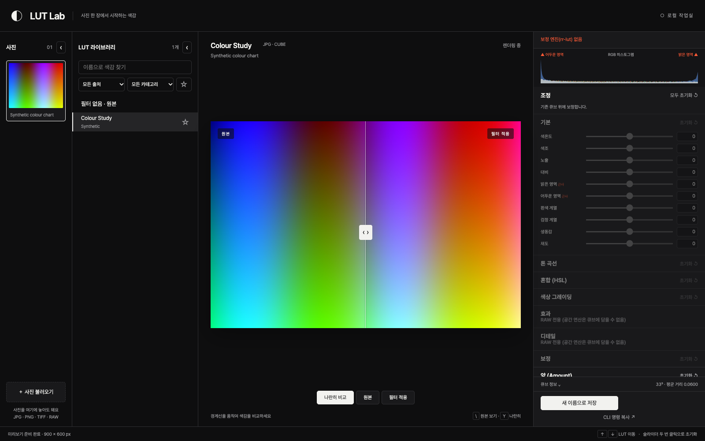

# LUT Lab

로컬 사진에 `.cube` LUT를 적용하고, 보정 전후를 비교하며, 새로운 LUT와 RAW 현상 설정을 저장하는 도구입니다. 브라우저와 macOS 네이티브 창에서 사용할 수 있습니다. 사진과 사용자 데이터는 저장소에 포함하지 않습니다.



스크린샷의 사진은 코드로 생성한 합성 컬러 차트입니다(`scripts/screenshot.py`).

## 설치와 실행

Python 3.11 이상과 uv가 필요합니다. 의존성 버전은 검증에 사용한 기존 환경과 동일하게 고정했습니다. 단, Python 3.11에서는 NumPy 2.0–2.3 계열을 사용합니다(고정한 2.5.3은 Python 3.12 이상 필요).

```sh
uv sync
uv run lut-lab
# 브라우저에서 http://127.0.0.1:8765 열기

# macOS 네이티브 앱
uv sync --group app
uv run --group app lut-lab-app
```

사진은 **불러오기** 버튼 또는 드래그 앤 드롭으로 가져옵니다. 가져온 파일은 데이터 폴더의 `uploads/`에 복사됩니다. 기존 사진을 복사하지 않고 보려면 `--photo-dir`를 지정하세요. 기본으로 검색하는 사진 폴더는 없습니다.

```sh
uv run lut-lab --data-dir ./user-data --lut-dir ./my-luts --photo-dir ./my-photos
uv run lut-lab --data-dir ./user-data --install-dir ./exports
```

`--lut-dir`, `--photo-dir`는 여러 번 지정할 수 있습니다. 데이터 폴더는 macOS에서 `~/Library/Application Support/LUT Lab`, 그 외 환경에서 `~/.lut-lab`입니다. 기본 LUT 폴더는 `<data>/luts`, 저장 위치는 `<data>/custom`입니다. 네이티브 앱 설정도 같은 데이터 폴더에 저장합니다.

**설치 폴더로 내보내기**는 `--install-dir`가 있거나 `<data>/config.json`에 `{"install_dir": "/path/to/exports"}`가 있을 때만 표시됩니다. 큐브와 XMP가 모두 이 폴더로 저장됩니다. CLI 설정이 우선하며 기존 파일은 명시적으로 덮어쓰기를 선택해야 바뀝니다.

## 선택 엔진

엔진은 CLI 옵션 → 환경변수 → 앱에 포함된 실행 파일 → PATH 순서로 찾습니다.

| 기능 | 엔진 | 설정 |
| --- | --- | --- |
| 기존 큐브 적용·미리보기·강도·저장 | 추가 엔진 불필요 | 기본 제공 |
| JPG 색상·곡선·그레이딩 보정 | rr-lut | `--rr-lut`, `RR_LUT` |
| RAW 현상·공간 효과·XMP | lightcraft-cli | `--lightcraft`, `LIGHTCRAFT_CLI` |

lightcraft-cli는 [LightCraft](https://github.com/storytold/lightcraft)(MIT/Apache-2.0)에서 `cargo build --release -p lightcraft-cli`로 빌드합니다.

rr-lut이 없으면 보정 패널에 **보정 엔진(rr-lut) 없음**을 표시하고 해당 보정을 비활성화합니다. 기존 큐브와 양(0–200%)은 계속 사용할 수 있습니다. lightcraft-cli가 없으면 RAW 현상 시 엔진 오류(503)를 표시합니다. RAW 썸네일과 업로드 검증은 rawpy를 사용합니다.

LightCraft 설정, 라이브러리, 임시 XMP는 실행마다 생성하는 임시 폴더에 격리합니다. 모든 LightCraft 프로세스에 임시 `LIGHTCRAFT_CONFIG_DIR`를 지정합니다. 원본 사진과 원본 옆 XMP에는 쓰지 않습니다.

## macOS 앱 빌드

```sh
uv sync --group app
bash scripts/build_app.sh
```

결과는 `dist/LUT Lab.app`입니다. `LIGHTCRAFT_CLI` 또는 PATH에서 찾은 LightCraft만 선택적으로 포함하고, MIT/Apache 라이선스 원문을 함께 넣습니다. 라이선스가 없으면 빌드를 중단합니다. rr-lut은 포함하지 않습니다. 빌드 스크립트는 앱에 ad-hoc 서명을 적용합니다. 공증된 배포판은 아닙니다.

아이콘 재생성: `uv run python scripts/make_icon.py` (macOS `iconutil` 필요).

## 검증

```sh
uv sync --group test
uv run --group test python tests/test_lut.py
uv run --group test python tests/test_lut_lab.py
uv run --group test python tests/test_lut_lab_app.py
uv run --group test python tests/test_standalone.py
node tests/test_lut_lab_state.cjs
node tests/test_lut_lab_app_ui.cjs
uv run --group test python tests/run_browser.py
```

Node 22 이상, Chrome, 로컬 포트 사용 권한이 있어야 마지막 브라우저 테스트가 동작합니다. 필요하면 `CHROME`으로 실행 파일을 지정합니다. 테스트는 임시 폴더에 합성 이미지와 LUT를 만들고 엔진 계약을 가짜 실행 파일로 검증합니다. 가짜 엔진 테스트는 실제 GPU의 색상 정확도를 검증하지 않습니다. 실제 RAW 테스트는 `LUT_LAB_RAW_SAMPLE`을 명시한 경우에만 실행하며 lightcraft-cli도 필요합니다.

`uv run python scripts/screenshot.py`는 실제 UI에 합성 데이터만 주입하여 스크린샷을 만듭니다. Chrome 실행이 불가능하면 `--chart-only`로 명확히 표시된 비교 이미지를 생성할 수 있습니다.

파이프라인, `index.json`, 레시피 형식: [docs/pipeline.md](docs/pipeline.md). 라이선스: [MIT](LICENSE), [THIRD_PARTY.md](THIRD_PARTY.md).

## English

LUT Lab is a local browser/native LUT editor. Import your own images, compare before/after, apply existing cubes without an external engine, and optionally use rr-lut for adjustments or LightCraft for RAW development. No photos or personal library are included.

Run `uv sync && uv run lut-lab`, then visit `http://127.0.0.1:8765`. Native macOS launch: `uv run --group app lut-lab-app`. Data and export destinations are configurable. LightCraft processes use temporary configuration directories. rr-lut is never bundled; see the third-party notices.
